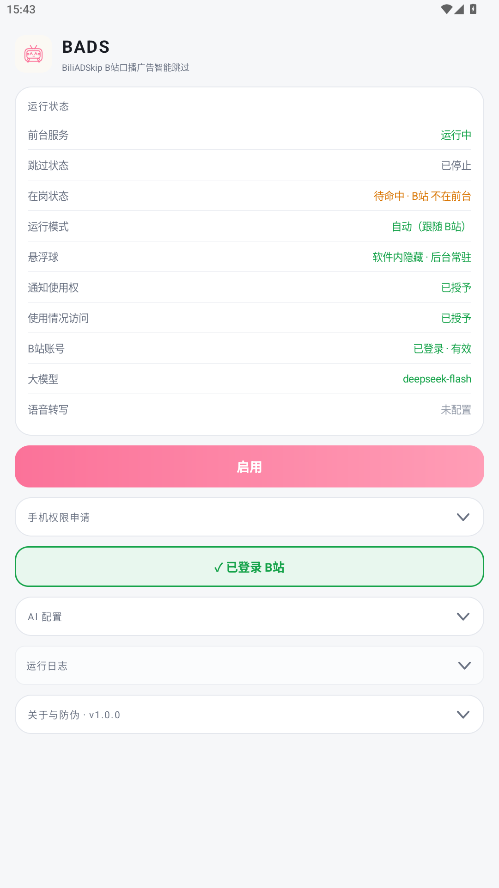

# BADS · BiliADSkip for Android

安卓端 **B站 口播广告自动跳过**：跟着 B站 播放自动启动，检测到「UP 主口播广告」的时间段后自动跳到广告结束处。

> **非官方声明**：本项目为个人非商业开源项目，与哔哩哔哩（B站）官方**没有任何关系**，未使用其闭源代码或素材；
> 应用图标为自绘。请勿用于商业用途或二次分发牟利。
>
> 本软件不会上架 Google Play（该类功能会被审核拒绝），只通过本仓库的 **Releases** 分发。

---

## 它做什么 / 不做什么

| | |
|---|---|
| ✅ 做 | 识别视频里**UP 主口播的广告段落**（"这条视频由 XX 赞助"这类），命中后自动跳过去 |
| ✅ 做 | 全程自动：进 B站 自动开始监测，离开 B站 自动待命，不需要手动开关 |
| ❌ 不做 | 不处理 B站 官方的贴片广告（那部分 B站 会员/客户端自己负责） |
| ❌ 不做 | 不修改 B站 客户端、不注入、不代理它的网络请求；只用系统公开的 MediaSession + 官方字幕/音频分析 |

## 截图

| 主界面（含在岗/待命状态） | 进 B站 即出现悬浮球（还没播放也会出现） |
|---|---|
|  |  |

## 工作原理

1. **认视频**：通过「通知使用权」读 B站 的 `MediaSession`，从 `MEDIA_ID` 反推 `aid` → 解析出 `bvid` / `cid`。
2. **判广告**：
   - 优先取**官方字幕**（`aisubtitle`）→ 交给你自己配置的大模型（OpenAI 兼容接口）判断哪几段是口播广告；
   - 没有字幕时，可选降级为**音频转写**（匿名下载音频 → Groq 转写 → 大模型分析，需要自备 Groq Key）；
   - 云端缓存只作为**加速层**：命中就直接用，未命中/置信度不足一律回到本地重新判定。
3. **跳过**：播放位置进入广告区间时，通过 `MediaSession` 的 `TransportControls.seekTo()` 跳到广告结束处，
   并**校验跳转结果**（调了没生效会重试，连续失败会明确提示"本机不允许自动跳转"）。
4. **在岗 / 待命 / 完全退出**（用系统「使用情况访问」判定 B站 是否在前台）：
   - B站 在前台 → **在岗**：悬浮球出现、跳过启用、通知显示"运行中"；
   - B站 离开前台 → **待命**：悬浮球收成侧边细条、跳过暂停生效、轮询降到 5 秒一次；
   - 离开超过 **3 分钟** → **完全退出**：停前台服务、撤掉通知、球窗口消失；
     之后再进 B站，由通知使用权服务在 B站 出现通知/播放会话时把整套链路唤醒。
   - 只是**按了暂停**不算离开：B站 仍在前台，球和监测都保持。

## 首次配置（4 个权限）

安装后打开应用，按「手机权限申请」里的 4 个按钮逐个授权（每个都已带 ✓ 状态）：

| 权限 | 为什么必须 |
|---|---|
| **通知使用权** | 第三方应用读 `MediaSession`（也就是"B站 在放什么、放到哪了"）的**唯一合法途径**，没有它完全无法识别视频 |
| **使用情况访问** | 判定「B站 是否在前台」的唯一依据。没有它就只能靠"有没有播放会话"反推，用户只打开 B站 首页、还没点视频时判不出来（球不出现、开关不启动） |
| **显示在其他应用上层** | 悬浮球窗口：既是状态指示灯，也是**保活**的关键——普通后台线程在别的 App 占前台时会被系统冻结，轮询就停了 |
| **电池优化白名单** | 避免系统在息屏/低电时把后台服务掐掉 |

另外 Android 13+ 会弹一次**通知权限**（POST_NOTIFICATIONS），授予即可，拒绝也不影响跳过功能。

还需要在「AI 配置」里填**大模型**（Base URL / API Key / Model，任何 OpenAI 兼容接口都可以）；
不填就只能靠云端缓存命中，未命中时无法本地判定。语音转写是可选项。

配好后点一次「启用」，之后就是全自动。

## 日常使用

- 悬浮球：轻点=暂停/恢复跳过，长按=打开主界面，拖动=换位置（8 秒不用会自动贴边变细条）。
- 暂停是**粘性**的：手动暂停后，B站 再播放也不会自动恢复，直到你手动点「启用」或点悬浮球。
- 状态、日志、权限、模型配置都在主界面，日志卡可展开/清空。

## 数据与隐私

| 数据 | 去向 | 是否上传 |
|---|---|---|
| 视频 `bvid` | 作者自建的云端缓存服务 `/api/cache/{bvid}` | **会上传**（只有 bvid，不含字幕、音频、账号） |
| 官方字幕文本 | 你配置的大模型接口（如 `api.deepseek.com`） | 会上传（用你自己的 Key，直连，不经作者服务器） |
| 音频（仅在无字幕且配了 Groq Key 时） | `api.groq.com` | 会上传（用你自己的 Key） |
| B站 登录 Cookie | 仅本机 `SharedPreferences`（明文） | **不上传**，只用于取官方字幕 |

> Cookie 以明文保存在应用私有目录，未做加密。介意的话可以不上传 Cookie（代价是没有官方字幕，只能用音频转写）。
> 默认的云端缓存地址写死在代码里；想换成自己的服务或彻底不用，改 `Prefs.workerUrl` 即可（欢迎提 PR 做成界面可配置）。

## 防伪校验（重要）

本仓库是**唯一发布来源**：`github.com/akiz0320/BiliAdSkip4Android`。APK 只从 **Releases** 下载，仓库里不放 APK。

发布者签名证书指纹（v1.0.0）：

```
SHA-256：F8:63:11:75:BC:12:D8:E2:C2:2E:4E:28:7D:A6:BF:78:9B:9B:F7:CB:C3:6B:7C:4A:0D:6C:86:00:49:40:04:89
```

> 这一串来自发布者持有的签名密钥（`bads-release.jks`，只在本地保管、绝不入库），
> 同时会显示在应用内「关于与防伪」页 —— 两处必须完全一致。

**校验方法**

```bash
# 1) 校验 APK（推荐）
keytool -printcert -jarfile BADS-v1.0.0.apk
#    输出的 SHA256 应与上面公布的指纹完全一致

# 2) 校验已安装的应用
#    打开应用 → 拉到底 → 「关于与防伪」→ 看"本机签名指纹 SHA-256"
#    不一致说明这个包不是本仓库构建/发布的

# 3) 从 keystore 直接读（发布者本人）
keytool -list -v -keystore bads-release.jks -alias bads
```

> 注意：自己用 Android Studio 跑 **debug** 构建时用的是 debug keystore，指纹**必然**和上面公布的不同——
> 那属于正常的本地构建，不算被篡改。

## 已知限制

- 只在 B站 处于前台时工作；离开超过 3 分钟会完全退出。
  **完全退出后**，如果你只是打开 B站 首页浏览、还没点进视频，应用不会自动拉起（要等 B站 出现通知或播放会话）；
  这一点是有意取舍：常驻会持续耗电，而完全退出后无法再判断前台应用。
- 识别依赖官方字幕 + 大模型，**可能误判**（把正常内容当广告，或漏掉广告）；音频转写方案更慢也更易错。
- 未登录 B站 时拿不到官方字幕，只能靠音频转写或云端缓存。
- 悬浮球的保活依赖"显示在其他应用上层"权限；部分 ROM 的省电策略仍可能限制后台，请一并加入白名单。
- 只在 MuMu 模拟器 + 少数真机上验证过；横竖屏切换会重新贴边，其他 ROM 的差异未逐一覆盖。

## 自行构建

环境：**JDK 17**、Android SDK（`compileSdk 35` / `buildTools 35.0.0`）、Gradle 8.12。

```bash
# 调试包（可直接装）
gradle -p BiliAdSkip assembleDebug      # 产物：BiliAdSkip/app/build/outputs/apk/debug/app-debug.apk

# 发布包（需要先配签名，见下）
gradle -p BiliAdSkip assembleRelease    # 产物：BiliAdSkip/app/build/outputs/apk/release/app-release.apk
```

**签名配置**（密钥只在本地保管，绝不入库）：

```bash
# 一次性生成 keystore，务必自己备份好：丢了就没法给老用户做版本升级
keytool -genkeypair -v -keystore bads-release.jks -alias bads \
        -keyalg RSA -keysize 2048 -validity 36500
```

然后在 `BiliAdSkip/local.properties`（已在 .gitignore 中）里加：

```properties
bads.storeFile=D:/keys/bads-release.jks
bads.storePassword=你的keystore口令
bads.keyAlias=bads
bads.keyPassword=你的别名口令
```

路径请用**正斜杠**（`local.properties` 是 properties 格式，单个反斜杠会被当转义符）。
也可以用环境变量：`BADS_STORE_FILE` / `BADS_STORE_PASSWORD` / `BADS_KEY_ALIAS` / `BADS_KEY_PASSWORD`。
没配签名时 `assembleRelease` 仍能构建，但产出的是**未签名包**（装不上）——这是刻意的，避免密钥进仓库。

发布新版本前记得把 `app/build.gradle` 里的 `versionCode` 加一，否则老用户覆盖安装不生效。

## 项目结构

```
BiliAdSkip4Android/
├── BiliAdSkip/                    # Android 工程
│   └── app/src/main/
│       ├── java/com/biliadskip/app/
│       │   ├── MediaWatcher.java      # 核心循环：会话识别 → 检测 → 跳过 + 在岗/待命判定
│       │   ├── BiliPresence.java      # 「B站 是否在前台」（使用情况访问）
│       │   ├── AdDetector.java        # 广告判定：字幕/音频 + 大模型 + 云端缓存
│       │   ├── BiliApi.java           # B站 接口 / 大模型 / Groq / 云端缓存调用
│       │   ├── BiliWatchService.java  # 前台服务 + 常驻通知
│       │   ├── FloatingBall.java      # 悬浮球（球形态 / 侧边细条）
│       │   ├── BiliSessionListener.java # 通知使用权 + 完全退出后的唤醒源
│       │   ├── MainActivity.java      # 状态、权限、配置、日志、关于与防伪
│       │   └── Prefs.java             # 本地设置存储
│       └── res/                       # 布局、图标（含单色通知图标）
└── docs/                          # README 用截图
```

## 免责声明

- 本项目为个人学习与自用工具，**与哔哩哔哩官方无关**；未使用其闭源代码、未修改其客户端。
- 使用本软件需要在你自己的账号下读取字幕/音频数据，**账号与 Cookie 的使用风险由使用者自负**；
  因使用本软件导致的任何账号异常、数据丢失或其他后果，作者不承担责任。
- 广告识别结果可能出错，请自行判断；请勿将本软件用于任何商业用途或二次分发牟利。
- 请遵守 B站 的用户协议与当地法律法规。

## 许可证

[MIT](LICENSE)
